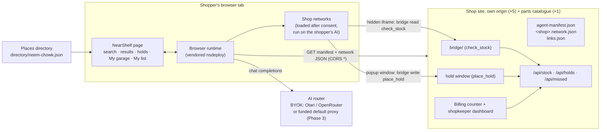
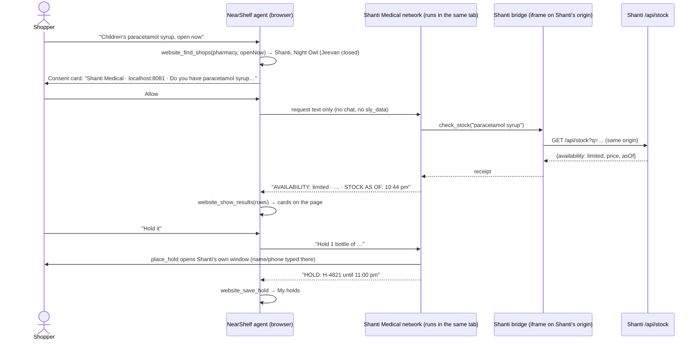

# NearShelf Architecture and Build Plan (shopper agent + seller agents)

> **For agentic workers:** this is the umbrella plan. Each phase gets its own step-level plan
> before it is built. Phase 1 is `2026-11-20-shopper-agent.md`. Use
> superpowers:subagent-driven-development or superpowers:executing-plans for a phase plan.

**Goal:** Build NearShelf for the Open Agentic Web Challenge: a shopper's personal agent site and the seller agent sites it asks (3 pharmacies, 2 parts dealers, 1 parts catalogue). Every site must conform to the MVP spec, and the whole set must make a 2-minute demo.

**Architecture:** Every site is an ordinary static website on its own origin. Each one publishes `agent-manifest.json`, a resolved `<network>.network.json` and a browser runtime, vendored unchanged from the organizers' agentify-website skill. The shopper's site (NearShelf) loads a shop's network into the shopper's browser after consent, and runs it on the shopper's AI router. That shop network reads live stock through the shop's bridge, a hidden frame on the shop's origin. Holds open in the shop's own window. Shop sites keep stock in a small same-origin API fed by a billing-counter page.

**Tech Stack:**
- Plain HTML, CSS and ES modules, with no framework and no npm dependencies.
- Node 22 for builds and tests (`node --test`).
- Vendored toolkit `vendor/agentify-website` (nsdeploy runtime, patched by agentic-web), pinned to agentic-web commit `05165377aca457381bd41b5c05e7a26cd23e6d74`.
- Deployment (Phase 3): Cloudflare Pages + Pages Functions + KV.

**Spec:** `docs/idea.md` (approved 2026-11-20) and the MVP spec, Profile 0.3: https://github.com/cognizant-ai-labs/agentic-web/blob/main/docs/worldwide_agentic_web_mvp_spec.md

## Global Constraints

- Node.js ≥ 22. No npm dependencies. Tests run with `node --test "<glob>"`, with the glob quoted.
- Copy `runtime/` into each site unchanged from `vendor/agentify-website/runtime`. Never edit by hand: `runtime/`, `<network>.network.json`, `agent-mcp.json`, `.well-known/*`, `bridge/action-bridge.html`, `bridge/agent-manifest.json`.
- Build every network with `node vendor/agentify-website/scripts/build_network.mjs <site>/<network>.hocon --manifest <site>/agent-manifest.json`. Fix every error and every warning.
- Keep the template `partner_rules` verbatim, with `website_<read_action>` replaced. Keep the template grounding sentences that the tests check.
- `peer_policy.mode` is `"closed"`, and `allowed_peers` lists exactly the origins the network calls.
- No keys, tokens or personal data in any published file. Never put a shopper's name, phone, email, address or hold code in a request to another site.
- All names are fictional: the "Neem Chowk" area, the shops, the vehicle maker "Vayu". Medicines use generic names only.
- Area time zone is `Asia/Kolkata`. Times are shown like `10:45 pm`, dates like `2026-11-20` plus `Fri, Nov 20, 2026`.
- The runtime limits each shopper message to 4 partner calls, 1 per partner network, 24 agent calls and 90 s. The shopper agent asks at most 4 shops per message.
- No medical advice, no dosing and no diagnosis. Prescription medicines can only be held. For an emergency, the agent says to call 112.
- Commits are atomic, with short conventional messages (`feat(nearshelf): …`). The author is the repo's git identity, with no co-author lines.

---

## 1. System overview



**The hero flow.** This is "children's paracetamol syrup, open now", on the NearShelf site.



## 2. Repository layout

```text
open_agent/
  README.md                       project overview, run commands
  package.json                    scripts only (no dependencies), "type": "module"
  .gitattributes .gitignore
  docs/
    idea.md                       approved idea
    superpowers/plans/            this plan + one plan per phase
  vendor/agentify-website/        organizers' toolkit, unchanged (UPSTREAM.md names the commit)
  sites/
    nearshelf/                    Phase 1: the shopper's personal agent (caller site)
    shanti_medical/               Phase 2: pharmacy, open till 11 pm
    night_owl_pharmacy/           Phase 2: pharmacy, 24 hours
    jeevan_chemist/               Phase 2: pharmacy, closes 9 pm
    bharat_auto_spares/           Phase 2: parts dealer
    speedline_moto_parts/         Phase 2: parts dealer
    vayu_parts_catalogue/         Phase 2: maker's parts catalogue (fitment look-up)
  shop-kit/                       Phase 2: "agentify a shop" kit
    template/                     the shop site template (pages, actions, bridge, network)
    shops/<id>.json               shop profiles (hours, policies, partners, theme)
    samples/<id>.csv              sample billing exports (fictional stock)
    generate.mjs                  profile + billing CSV → sites/<id>/ (then builds the network)
    api/                          shop API handlers (pure functions + storage interface)
  tools/                          Phase 3: dev.mjs (run all sites), release.mjs (prod URLs → dist/)
```

## 3. Components

### 3.1 Shopper agent: NearShelf (`sites/nearshelf`, Phase 1)

A personal agent page. All personal data stays on the device.

| Part | Responsibility |
|---|---|
| `index.html`, `styles.css` | Search-first page: the "What do you need?" form, results board, My holds, shops near you, area and demo time, My garage, My list, and the assistant (chat, agent activity, AI settings) |
| `js/clock.js` | Neem Chowk time (IST) from any browser time zone, plus an optional demo time of day |
| `js/directory.js` | Validates the places directory, works out open/closed labels (24 h and past midnight), distance, and the shortlist |
| `js/fewest-stops.js` | Finds the fewest shops that cover a whole list |
| `js/profile-store.js` | On-device profile: spot, demo time, vehicles, regular medicines, holds. Survives blocked storage |
| `js/render.js`, `js/app.js` | The page object `App.page`: state reader, operations, rendering |
| `site-actions.js` | Website tools: `get_shopper_state` (read), `find_shops` (read), `plan_fewest_stops` (read), `show_results` (write), `save_hold` (write) |
| `nearshelf.hocon` → `nearshelf.network.json` | Front agent `nearshelf_assistant` (asks shops) + `parts_fitment_specialist` (asks the parts catalogue) |
| `agent-manifest.json`, `links.json`, `site.js`, `_headers` | Publication, boot, hosting headers |

### 3.2 Seller agents: shop template (`shop-kit/`, Phase 2)

One template, generated per shop from a profile and a billing export.

| Part | Responsibility |
|---|---|
| `index.html` | The shop's public page: name, address, hours, verified badge, "Ask the shop" assistant |
| `counter.html` | Billing counter (demo stand-in for billing software): bill an item, and stock drops at once |
| `dashboard.html` | Shopkeeper view: today's holds, missed demand (items asked for but not in stock), referrals |
| `api/` (same origin) | `GET /api/stock?q=` (availability bands, logs misses) · `POST /api/sale` · `POST /api/holds` · `GET /api/holds` · `GET /api/missed` |
| `site-actions.js` | Local tools for the shop's own page: `check_stock` (read), `get_shop_info` (read), `place_hold` (irreversible, shop's dialog) |
| `bridge/bridge-actions.js` | Shared with callers: `check_stock` (read, `callerOrigins: ["*"]`, because the shop page shows the same bands) and `get_shop_info` (read, `"*"`) |
| `bridge/hold-window.js` | Shared write `place_hold`: opens the shop's own window. The visitor types name and phone there. Returns only `{code, until}`. `callerOrigins` = NearShelf + partner shops (never `"*"`) |
| `<shop>.hocon` | Front agent `<shop>_assistant`. Partner tools are the shop's referral partners (Shanti → Night Owl) |

**Pharmacy rules:** prescription-schedule items (Schedule H, H1 or X in the CSV) can only be held, never sold online. No advice.

**Parts rules:** answer by part number. Say genuine or compatible.

**Parts catalogue (`vayu_parts_catalogue`):** a read `lookup_part(vehicle, part)` returns the part number, name and compatible alternatives. It is shared via the bridge with `"*"`. It has no counter and no holds.

### 3.3 Shared contracts (both sides build against these)

**Places directory v1** (`sites/nearshelf/directory/neem-chowk.json`, public, CORS `*`):

```json
{
  "format": "nearshelf-places/v1",
  "area": {"id": "neem-chowk", "name": "Neem Chowk", "timezone": "Asia/Kolkata"},
  "spots": [{"id": "metro-gate", "name": "Neem Chowk Metro, Gate 2", "lat": 28.6, "lng": 77.2}],
  "places": [{
    "id": "shanti_medical", "name": "Shanti Medical", "category": "pharmacy",
    "address": "14 Gandhi Road, Neem Chowk", "lat": 28.6012, "lng": 77.2016,
    "hours": {"mon": [["09:00", "23:00"]], "sun": [["10:00", "23:00"]]},
    "verified": {"by": "Neem Chowk Chemists' Association (demo)", "ref": "DL-NC-0142 (demo)"},
    "agent": {"network": "http://localhost:8081/shanti_medical", "label": "Shanti Medical"},
    "page": "http://localhost:8081/"
  }]
}
```

- **Categories:** `pharmacy`, `auto_parts`, `parts_catalogue`.
- **Hours:** per weekday (`mon`…`sun`) as lists of `[start, end]`. `"24:00"` means end of day, and `end ≤ start` means the range runs past midnight. A missing day means closed.
- **Partner tool name:** the last path segment of `agent.network`.

**Availability answer v1.** A shop agent's reply to a stock request starts with one line:
`AVAILABILITY: in_stock|limited|out_of_stock · ITEM: <name, strength, pack> · PRICE: <₹…> · STOCK AS OF: <10:44 pm> · HOLD: yes|no|prescription`

- The values follow schema.org `ItemAvailability` (InStock, LimitedAvailability, OutOfStock).
- Stock is reported in bands: `limited` means 1–3 left.
- NearShelf maps the reply onto `show_results` rows. The availability enum adds `no_answer` and `declined`.

**Hold receipt v1.** `HOLD: <code> until <time>`, with the code shaped like `H-` plus 4 digits. Names and phones never leave the shop's window.

## 4. Local development topology

The build script allows plain `http` only for `localhost`, `127.0.0.1` and `[::1]`. NearShelf gets its own host name, so its saved key (mirrored to a cookie on loopback hosts) never reaches a shop.

| Site | Network URL | Serve command (from repo root) |
|---|---|---|
| NearShelf | `http://127.0.0.1:8080/nearshelf` | `node vendor/agentify-website/scripts/serve_site.mjs sites/nearshelf --port 8080 --open-as 127.0.0.1` |
| Shanti Medical | `http://localhost:8081/shanti_medical` | `… sites/shanti_medical --port 8081 --open-as localhost` |
| Night Owl Pharmacy | `http://[::1]:8082/night_owl_pharmacy` | `… sites/night_owl_pharmacy --host ::1 --port 8082` |
| Jeevan Chemist | `http://localhost:8083/jeevan_chemist` | `… --port 8083 --open-as localhost` |
| Bharat Auto Spares | `http://localhost:8084/bharat_auto_spares` | `… --port 8084 --open-as localhost` |
| Speedline Moto Parts | `http://[::1]:8085/speedline_moto_parts` | `… --host ::1 --port 8085` |
| Vayu Parts Catalogue | `http://[::1]:8086/vayu_parts_catalogue` | `… --host ::1 --port 8086` |

The referral pair (Shanti on `localhost` → Night Owl on `[::1]`) also uses separate host names.

## 5. Deployment (Phase 3)

- **Hosting:** one Cloudflare Pages project per site, so each site has its own origin, for example `nearshelf.pages.dev` and `shanti-medical.pages.dev`. Each site ships a `_headers` file: CORS `*` on the public agent files, the sandbox-worker CSP, and no frame blocking on `bridge/`.
- **Shop APIs:** Pages Functions under `/api/*`, with a KV namespace per shop, all same-origin. The bridge, hold window and counter all call their own origin, so no CORS is needed.
- **Funded default model (decided in the idea):** NearShelf's `llm_router.base_url` points at its own `/api/llm/v1`, with `mock: true`. Per the runtime's router selection, that means no visitor key. A Pages Function forwards requests to Otari with the server-side key, a model allowlist (`alibaba/qwen3.8-flash`), per-IP rate limits and a daily spend cap, until judging ends (~2027-01-19). `byok_router` stays Otari for visitors who bring their own key.
- **Production URLs:** `tools/release.mjs` copies `sites/*` to `dist/*`, swaps each local origin for its production origin (hocon, manifest, directory, link labels, allowed peers), then rebuilds every network in `dist/`.
- **The user's own steps:** creating the Cloudflare and Otari accounts and setting secrets, registering on NANDA Index, and opening the PR to the community `agentic_websites.md` list.

## 6. Spec conformance map

| MVP requirement | Where |
|---|---|
| Two-agent HOCON network + manifest on HTTPS | `nearshelf.hocon` (front + fitment specialist), every `agent-manifest.json` |
| Runs in the browser with the site's default router, plus BYOK | Vendored runtime, `llm_router`, ⚙ AI model settings, funded proxy (Phase 3) |
| Internal agent + grounded capability (site action) | `parts_fitment_specialist`, `website_find_shops` / `check_stock` |
| Load an exact named network from a second origin after approval | NearShelf → shop networks (consent card) |
| Key never reaches the second site; peer can't change the router | Runtime (`selectPeerRouter`), different host names locally |
| Private context absent at the peer | Profile stays on-device; partner requests carry item text only |
| Invalid network, cycle, over-budget request, denied origin all stop with visible errors | Runtime limits; tests in Phase 1 (network validity) and Phase 3 (denied origin check) |
| Honest outcomes / fail closed | `no_answer` / `declined` rows, `unknown` receipts never retried |

## 7. Demo plan (2-minute video, narrated by you)

| Time | Shot | What must already work |
|---|---|---|
| 0:00–0:15 | Hook: "Bhaiya, hai kya?" Phoning shops at night | — |
| 0:15–0:50 | NearShelf at demo time 10:45 pm: ask for children's paracetamol syrup, consent card, Shanti "few left", Night Owl "out", Jeevan skipped (closed); Hold → Shanti's window → code in My holds | Phase 1 + Shanti/Night Owl/Jeevan (Phase 2) |
| 0:50–1:15 | Split screen: Shanti's counter bills the last ORS; a second shopper on Shanti's own site hears "sold out" and Shanti refers to Night Owl | Phase 2 counter + referral |
| 1:15–1:40 | "Clutch cable for my 2019 Vayu Zip 125": specialist → catalogue part number → 2 dealers asked | Phase 2 catalogue + dealers |
| 1:40–1:55 | Shopkeeper dashboard: missed demand; "agentify your shop" kit command | Phase 2 dashboard + kit |
| 1:55–2:00 | Close line | — |

**Recording checklist:**
- Record on the deployed HTTPS sites, with the funded default model on.
- Set browser zoom to 110%. Clear old holds first.
- Use NearShelf's demo time, or record at night IST, so "open now" matches the story.
- No real brands on screen.
- Capture 3–5 screenshots: the results board, the consent card, the hold window, the counter, the dashboard.

## 8. Phases and milestones

| Phase | What | Target |
|---|---|---|
| 1 | Shopper agent (NearShelf), tested locally with BYOK | 2026-11-24 |
| 2 | Shop kit + 5 shops + parts catalogue, with counter, dashboard, bridge reads/writes and referrals | 2026-12-08 |
| 3 | Dev orchestrator, end-to-end live check, Cloudflare deploy, funded model proxy, release script | 2026-12-20 |
| 4 | Video, screenshots, Devpost text, Otari feedback, community list PR | 2027-01-06 |
| — | Buffer; submission deadline 2027-01-11 16:00 UTC | 2027-01-11 |

## 9. Known limits (state them in the submission)

- Each shopper message reaches at most 4 shops (runtime limit), so the agent offers "ask a few more" in the next message.
- The runtime runs `write` actions without a dialog (a gap against spec §3.1). NearShelf's writes only change its own on-page panels.
- Partners are declared up front (`allowed_peers` and partner tools), so a new shop needs a NearShelf rebuild. Dynamic peers from a trusted directory are a proposed community extension.
- The browser runtime only works while the tab is open, so there are no "back in stock" alerts.
- The demo counter stands in for real billing software. A real shop would run a sync helper.
